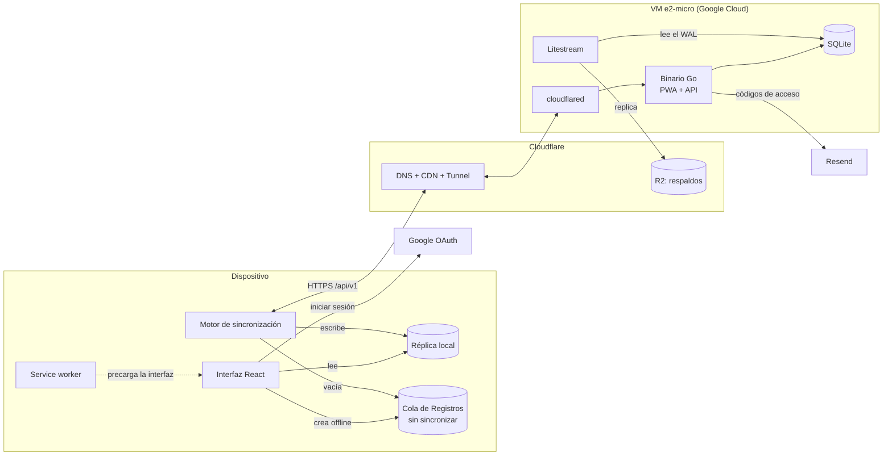
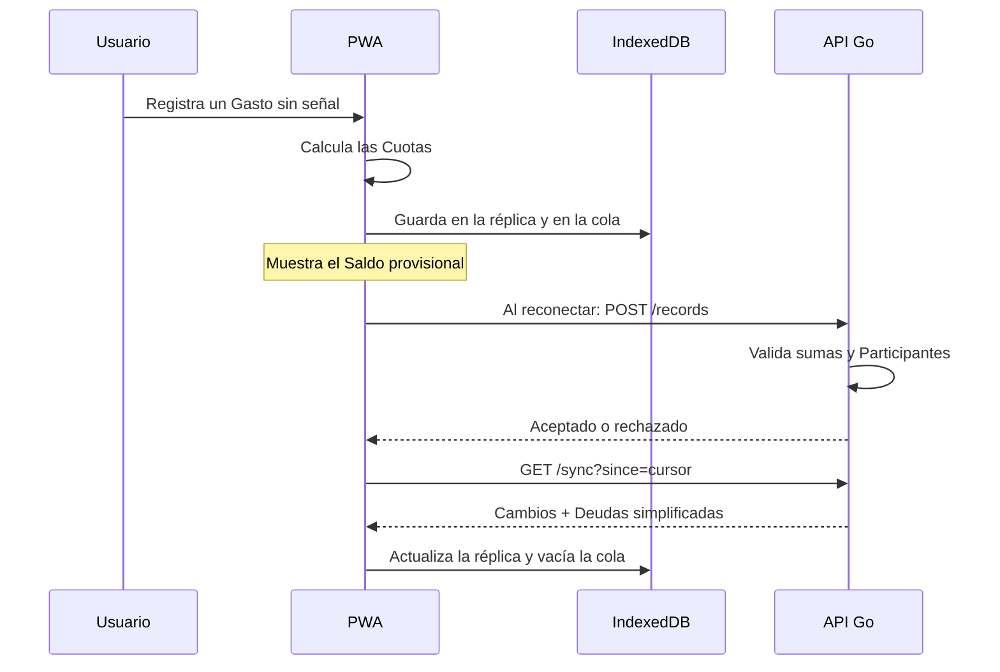

# Arquitectura

Cómo se construye la aplicación. El vocabulario sigue [CONTEXT.md](../CONTEXT.md), las decisiones con historia están en [adr/](adr/) y las reglas en [reglas-de-negocio.md](reglas-de-negocio.md).

## Resumen

Una PWA en React que guarda en el dispositivo una réplica de todos los datos del Usuario, y un único binario Go que sirve la PWA y la API y guarda los datos en SQLite. El binario corre en una VM gratuita de Google Cloud detrás de Cloudflare, que pone el DNS, la CDN, el túnel de entrada y el almacenamiento de los respaldos.



## Cliente (`web/`)

- **React + Vite + TypeScript**, como SPA. No necesita renderizado en servidor porque todo está detrás del inicio de sesión.
- **Service worker** (`vite-plugin-pwa` / Workbox): precarga la interfaz para que abra sin red. No guarda respuestas de la API en caché; los datos viven en la réplica.
- **Réplica local** en IndexedDB con Dexie. La interfaz siempre lee de la réplica, con o sin conexión, así que se comporta igual en ambos casos.
- **Cola de Registros sin sincronizar**: Gastos y Liquidaciones creados sin conexión, también en IndexedDB ([ADR 0001](adr/0001-offline-solo-creacion.md)).
- **Motor de sincronización**: trae cambios y vacía la cola al abrir la app, al volver a ella, al recuperar la conexión y después de cada cambio. No usa Background Sync porque Safari en iOS no lo soporta.
- **Operaciones solo en línea** (editar, borrar y crear Grupos, Miembros o Amigos): llaman directamente a la API con TanStack Query y después sincronizan.
- **`domain/`**: funciones puras de TypeScript que convierten un Método de reparto en Cuotas, reparten el sobrante y calculan Saldos provisionales ([ADR 0003](adr/0003-cliente-calcula-cuotas.md)). Es el código más probado del cliente.
- **Cliente de API** generado desde `openapi.yaml` con `openapi-typescript`.
- **i18n** preparada desde el inicio; la v1 solo trae español.

## Servidor (`api/`)

- **Un solo binario Go** que sirve la PWA compilada (embebida con `embed`) y la API bajo `/api/v1`. Al compartir origen no hace falta CORS y las cookies son simples.
- **HTTP**: `net/http` estándar. Los tipos y la interfaz de los manejadores se generan desde `openapi.yaml` con `oapi-codegen`.
- **Datos**: SQLite en modo WAL con `modernc.org/sqlite` (Go puro, sin cgo, fácil de compilar para Linux desde cualquier máquina). Las consultas se escriben en SQL y `sqlc` genera el código Go con tipos. Las migraciones van con `goose` y se aplican al arrancar. El SQL se mantiene portable a PostgreSQL ([ADR 0006](adr/0006-sqlite.md)).
- **Dominio**: valida Gastos y Liquidaciones (sumas y Participantes) y calcula Saldos y la Simplificación de deudas. No reimplementa los Métodos de reparto.
- **Autenticación**: código de 6 dígitos por email (enviado con Resend) o Google con OpenID Connect ([ADR 0005](adr/0005-login-con-codigo-no-enlace.md)). La sesión es una cookie HttpOnly con un token opaco; en la base solo se guarda su hash. Caduca a los 90 días sin uso y se puede cerrar por dispositivo.

## Infraestructura ([ADR 0007](adr/0007-go-nativo-en-vm-gratuita.md))

| Pieza | Servicio | Costo |
| --- | --- | --- |
| Servidor | Google Cloud `e2-micro` en `us-east1`, la región gratuita más cercana a Latinoamérica | 0 |
| DNS, CDN y TLS | Cloudflare | 0 |
| Entrada al servidor | Cloudflare Tunnel (`cloudflared`): la VM no abre puertos públicos | 0 |
| Respaldos | Litestream → Cloudflare R2 | 0 hasta 10 GB |
| Emails | Resend | 0 hasta 3.000 al mes |
| Código y CI | GitHub + Actions | 0 |
| Dominio | Registrador a elegir | ~10–15 USD/año |

## Sincronización

### Traer cambios

- Cada escritura en el servidor recibe un número de versión de un contador global. Como SQLite tiene un único escritor, el contador es estrictamente creciente sin esfuerzo.
- `GET /api/v1/sync?since=<cursor>` devuelve todo lo que cambió, con versión mayor que el cursor, en los Grupos y Amistades del Usuario, incluidos los borrados (para quitarlos de la réplica), junto con el cursor nuevo.
- Con el cursor en 0 se descarga todo; así ocurre el primer inicio de sesión en un dispositivo.
- Al unirse a un Grupo, el siguiente pull incluye ese Grupo completo aunque sus cambios sean anteriores al cursor.
- La respuesta incluye las Deudas ya simplificadas de cada Grupo que cambió, para poder mostrarlas sin conexión.

### Enviar Registros sin sincronizar

- `POST /api/v1/records` recibe un lote de Gastos y Liquidaciones. Cada uno trae un identificador generado en el cliente (UUIDv7), así que reenviar el lote nunca duplica nada.
- Cada registro indica la Moneda del grupo que conocía el cliente; si ya no coincide, se rechaza (ver [reglas](reglas-de-negocio.md#moneda-del-grupo)).
- La respuesta dice, para cada registro, si fue aceptado o rechazado y por qué. Los rechazados quedan como Registros rechazados.

### Editar en línea

- Cada Gasto lleva su versión. `PATCH` envía la versión esperada; si no coincide, la API responde `409 Conflict` y la interfaz muestra "Este gasto cambió mientras lo editabas".



## Modelo de datos

Los importes se guardan como enteros en la unidad mínima de su moneda (centavos) y las monedas como código ISO 4217. Nunca se usan decimales de coma flotante.

Un **libro** (`Ledger`) es el contenedor de Gastos y Liquidaciones. Cada Grupo tiene uno, y cada Amistad también, como un libro de exactamente dos Miembros ([ADR 0008](adr/0008-grupos-y-amistades-comparten-libro.md)). Los nombres del código están en inglés y siguen la traducción de [CONTEXT.md](../CONTEXT.md) ([ADR 0009](adr/0009-codigo-en-ingles.md)).

| Tabla | Contenido |
| --- | --- |
| `users` | email, nombre, Moneda preferida, identificador de Google, fecha de borrado |
| `sessions` | hash del token, dispositivo, último uso |
| `login_codes` | hash del código, caducidad, intentos |
| `ledgers` | tipo (`group` o `friendship`), nombre, Moneda del grupo (vacía en Amistades), Simplificación de deudas, hash del Enlace de invitación, versión |
| `members` | libro, Usuario vinculado (vacío si está pendiente), nombre, email, estado (`active` o `former`) |
| `expenses` | identificador del cliente, libro, descripción, fecha, moneda, total, Categoría, Método de reparto (para reeditar), autor, versión, fecha de borrado |
| `paid_shares`, `owed_shares` | gasto, miembro, importe (Aportes y Cuotas) |
| `settlements` | libro, de quién, a quién, importe, moneda, fecha, autor, versión, fecha de borrado |
| `activities` | libro, Usuario, qué cambió, cuándo |

Los Saldos no se guardan: se calculan sumando, lo cual es rápido a esta escala.

## Seguridad

- Toda consulta se limita a los libros en los que el Usuario tiene un Miembro activo.
- Cookie `HttpOnly`, `Secure` y `SameSite=Lax`. Además, las peticiones que modifican datos deben traer un encabezado `Origin` del propio dominio (protección CSRF).
- Los códigos de acceso caducan a los 10 minutos y admiten 5 intentos como máximo. También se limitan los envíos por email y por IP.
- Los Enlaces de invitación y los tokens de sesión son aleatorios, y en la base solo se guarda su hash.
- Hay un límite de peticiones por IP en Go, además del de Cloudflare.

## Repositorio

```
/
├── CONTEXT.md
├── openapi.yaml              contrato entre cliente y servidor
├── docs/
│   ├── arquitectura.md
│   ├── reglas-de-negocio.md
│   └── adr/
├── api/                      Go
│   ├── cmd/server/           punto de entrada
│   ├── internal/
│   │   ├── domain/           validación, Saldos, Simplificación de deudas
│   │   ├── httpapi/          manejadores (interfaz generada por oapi-codegen)
│   │   ├── store/            consultas SQL y código generado por sqlc
│   │   ├── auth/             códigos de acceso, Google, sesiones
│   │   ├── sync/             cursores, pull y push
│   │   └── mail/             envío con Resend
│   └── migrations/           goose
├── web/                      React + Vite
│   └── src/
│       ├── domain/           Métodos de reparto, Saldos provisionales
│       ├── local/            réplica y cola en IndexedDB (Dexie)
│       ├── sync/             motor de sincronización
│       ├── api/              cliente generado desde openapi.yaml
│       ├── ui/
│       └── i18n/
├── deploy/                   servicios systemd, litestream.yml, cloudflared
└── .github/workflows/
```

## Despliegue y operación

- En cada push, GitHub Actions ejecuta las pruebas de Go y de TypeScript, compila la PWA y la embebe en el binario Go (`linux/amd64`).
- En cada push a `main`, copia el binario a la VM por SSH a través del túnel y reinicia el servicio. El reinicio dura alrededor de un segundo, aceptable en la v1.
- La VM tiene tres servicios systemd: la aplicación, Litestream y `cloudflared`.
- La restauración del respaldo (`litestream restore`) se prueba periódicamente.

## Límites conocidos y cuándo crecer

- `e2-micro`: 2 vCPU compartidas y 1 GB de RAM. Un binario Go con SQLite cabe con holgura para miles de Usuarios.
- 1 GB de salida al mes: los archivos estáticos salen de la caché de Cloudflare, pero conviene vigilar el consumo de la API.
- Siguiente paso: un VPS de pago con el mismo binario y el mismo archivo ([ADR 0007](adr/0007-go-nativo-en-vm-gratuita.md)). Si algún día hiciera falta más de una máquina, PostgreSQL ([ADR 0006](adr/0006-sqlite.md)).
