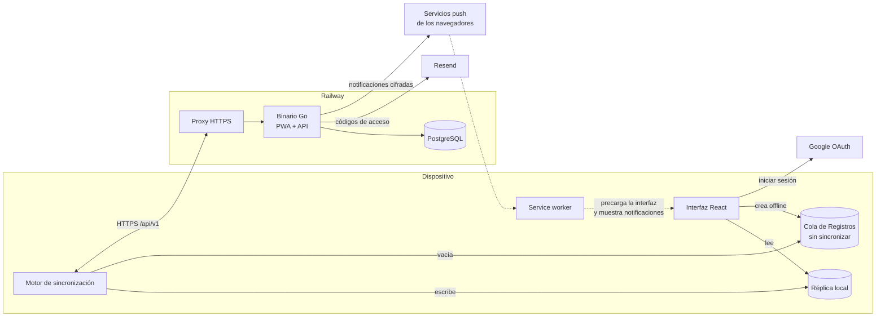
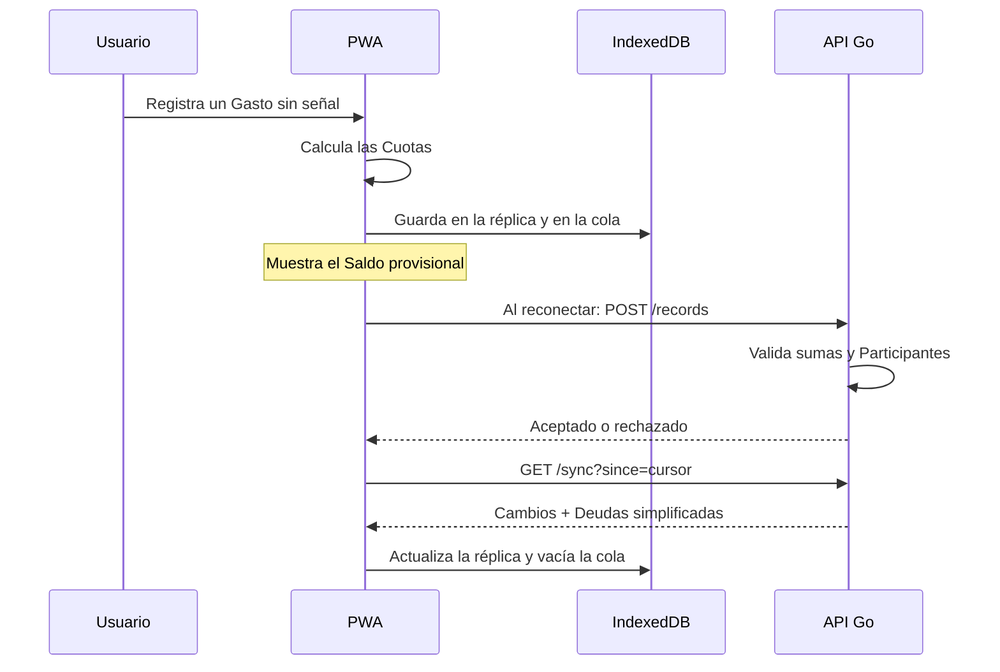

# Arquitectura

Cómo se construye la aplicación. El vocabulario sigue [CONTEXT.md](../CONTEXT.md), las decisiones con historia están en [adr/](adr/) y las reglas en [reglas-de-negocio.md](reglas-de-negocio.md).

## Resumen

Una PWA en React que guarda en el dispositivo una réplica de todos los datos del Usuario, y un único binario Go que sirve la PWA y la API y guarda los datos en PostgreSQL. El binario y la base corren en Railway, que pone el TLS, el dominio, los despliegues y los respaldos.



## Cliente (`web/`)

- **React + Vite + TypeScript**, como SPA. No necesita renderizado en servidor porque todo está detrás del inicio de sesión.
- **Service worker** (`web/src/sw.ts`, con Workbox): precarga la interfaz para que abra sin red y muestra las notificaciones push ([ADR 0013](adr/0013-avisos-en-vivo-y-push.md)). No guarda respuestas de la API en caché; los datos viven en la réplica.
- **Réplica local** en IndexedDB con Dexie. La interfaz siempre lee de la réplica, con o sin conexión, así que se comporta igual en ambos casos.
- **Cola de Registros sin sincronizar**: Gastos y Liquidaciones creados sin conexión, también en IndexedDB ([ADR 0001](adr/0001-offline-solo-creacion.md)).
- **Cuando la sesión termina sola** (caduca, se cierra desde otro dispositivo o se borra la cuenta), el primer 401 borra la réplica y deja la cola. Si entra otro Usuario, la cola del anterior se aparta, oculta, bajo su id, y vuelve cuando su dueño entra de nuevo en ese dispositivo. La réplica guarda quién es su dueño, así que el cambio de manos es una sola transacción.
- **Motor de sincronización**: trae cambios y vacía la cola al abrir la app, al volver a ella, al recuperar la conexión, después de cada cambio y cuando el servidor avisa por `GET /events` que un libro cambió. No usa Background Sync porque Safari en iOS no lo soporta. Cada petición tiene un plazo de 60 segundos, y al volver a la app o recuperar la conexión el sync en curso se abandona y empieza de nuevo: un teléfono que pierde la red a mitad de una petición puede no recibir nunca la respuesta. Si el servidor responde con un error a `GET /events`, el navegador no reintenta, así que la PWA abre el stream de nuevo a los 10 segundos.
- **Diagnóstico** (`web/src/diagnostics.ts`): guarda en `localStorage` las consultas a la réplica que fallan o tardan más de 5 segundos, los syncs fallidos, los cortes del stream de avisos, los errores sin atender y lo que el navegador hace con la página en segundo plano. Cuenta lo muestra para que el Usuario mande una captura. Una consulta que falla se reintenta en vez de dejar la pantalla vacía.
- **Operaciones solo en línea** (editar, borrar y crear Grupos, Miembros o Amigos): llaman directamente a la API con TanStack Query y después sincronizan.
- **`domain/`**: funciones puras de TypeScript que convierten un Método de reparto en Cuotas, reparten el sobrante y calculan Saldos provisionales ([ADR 0003](adr/0003-cliente-calcula-cuotas.md)). Es el código más probado del cliente.
- **Cliente de API** generado desde `openapi.yaml` con `openapi-typescript`.
- **i18n** preparada desde el inicio; la v1 solo trae español.

## Servidor (`api/`)

- **Un solo binario Go** que sirve la PWA compilada (embebida con `embed`) y la API bajo `/api/v1`. Al compartir origen no hace falta CORS y las cookies son simples.
- **HTTP**: `net/http` estándar. Los tipos y la interfaz de los manejadores se generan desde `openapi.yaml` con `oapi-codegen`.
- **Datos**: PostgreSQL, con el driver `pgx` usado a través de `database/sql` ([ADR 0012](adr/0012-postgres-en-railway.md)). La base se elige con `QUITSIE_DATABASE_URL`, así que cambiar de proveedor es cambiar esa URL. Las consultas se escriben en SQL y `sqlc` genera el código Go con tipos. Las migraciones van con `goose` y se aplican al arrancar.
- **Transacciones**: las de escritura toman un bloqueo consultivo (`pg_advisory_xact_lock`) y corren una detrás de otra, así que una que lee y después escribe (un límite, un email único, la siguiente versión) nunca compite con otra. Las lecturas que necesitan una sola foto de la base, como un pull, corren en `REPEATABLE READ`.
- **Dominio**: valida Gastos y Liquidaciones (sumas y Participantes) y calcula Saldos y la Simplificación de deudas. No reimplementa los Métodos de reparto.
- **Avisos** ([ADR 0013](adr/0013-avisos-en-vivo-y-push.md)): un trigger de PostgreSQL hace `NOTIFY` en cada escritura de un libro. `internal/changefeed` lo escucha y lo reparte a las conexiones SSE de `GET /events` y al notificador push de `internal/push`, que envía con Web Push y claves VAPID.
- **Autenticación**: código de 6 dígitos por email (enviado con Resend) o Google con OpenID Connect ([ADR 0005](adr/0005-login-con-codigo-no-enlace.md)). Google solo se ofrece si el servidor tiene configurado su cliente OAuth: la PWA lo pregunta con `GET /auth/methods` y, si no, no muestra el botón. La sesión es una cookie HttpOnly con un token opaco; en la base solo se guarda su hash. Caduca a los 90 días sin uso y se puede cerrar por dispositivo.

## Infraestructura ([ADR 0012](adr/0012-postgres-en-railway.md))

| Pieza | Servicio |
| --- | --- |
| Servidor | Railway, con la imagen del `Dockerfile` |
| Base de datos | PostgreSQL en Railway, en el mismo proyecto |
| TLS y dominio | Railway |
| Respaldos | Los de la base de Railway |
| Emails | Resend, gratis hasta 3.000 al mes |
| Código y CI | GitHub + Actions |
| Dominio propio | Registrador a elegir, ~10–15 USD al año |

El precio de Railway depende del plan y del uso; está en su panel.

## Sincronización

### Traer cambios

- Cada transacción de escritura toma el siguiente número del contador global (la tabla `version_counter`, de una sola fila) y lo pone en todas las filas que crea o cambia: libros, Miembros, Gastos, Liquidaciones y Actividades. Incrementar esa fila bloquea a los demás escritores hasta que la transacción termina, así que las versiones siguen el orden en que se confirman las escrituras y un pull nunca se salta un cambio. Una secuencia no lo garantiza: una transacción puede tomar un número y confirmarse después de otra que tomó uno mayor.
- `GET /api/v1/sync?since=<cursor>` devuelve todo lo que cambió, con versión mayor que el cursor, en los Grupos y Amistades del Usuario, incluidos los borrados (para quitarlos de la réplica), junto con el cursor nuevo.
- Los libros, Gastos y Liquidaciones no se borran físicamente: borrarlos les pone fecha de borrado y una versión nueva, y así el pull se entera. Un Miembro que sale de un Grupo pasa a `former`, también con versión nueva. Los Aportes y las Cuotas viajan con su Gasto y no tienen versión propia.
- Con el cursor en 0 se descarga todo; así ocurre el primer inicio de sesión en un dispositivo.
- Cada respuesta trae unas 20.000 filas como máximo. Si queda más, lleva `hasMore` y un cursor intermedio, y el cliente vuelve a pedir desde ese cursor. Cada fila cuenta en su versión o en la del Miembro del Usuario, la que sea mayor, así que un Grupo recién unido llega entero en una página y una escritura nunca se parte.
- Al unirse a un Grupo, el siguiente pull incluye ese Grupo completo aunque sus cambios sean anteriores al cursor.
- Cada pull incluye la lista de libros que el Usuario puede ver. El cliente suelta de su réplica cualquier otro, por ejemplo cuando sale de un Grupo o cuando alguien deshace su Reclamación.
- La respuesta incluye las Deudas ya simplificadas de cada Grupo que cambió, para poder mostrarlas sin conexión.

### Enviar Registros sin sincronizar

- `POST /api/v1/records` recibe un lote de Gastos y Liquidaciones. Cada uno trae un identificador generado en el cliente (UUIDv7), así que reenviar el lote nunca duplica nada.
- Cada registro indica la Moneda del grupo que conocía el cliente; si ya no coincide, se rechaza (ver [reglas](reglas-de-negocio.md#moneda-del-grupo)).
- La respuesta dice, para cada registro, si fue aceptado o rechazado y por qué. Los rechazados quedan como Registros rechazados.

### Editar en línea

- Cada Gasto lleva su versión. `PATCH` envía la versión esperada; si no coincide, la API responde `409 Conflict` y la interfaz muestra "Este gasto cambió mientras lo editabas".



### Restaurar un respaldo

Un respaldo restaurado es una copia vieja de la base. La base perdida pudo entregar versiones por encima del contador del respaldo, y si el contador siguiera desde ahí, un dispositivo con el cursor entre ellas se saltaría filas nuevas y conservaría para siempre las que el servidor perdió. Por eso, después de restaurar, `quitsie record-restore` hace saltar el contador hasta la hora actual en microsegundos, o mil millones de versiones si eso llega más lejos, y anota el tramo saltado en `restore_gaps`. `GET /sync` responde `410` a un cursor dentro de un tramo, igual que a uno por delante del servidor, y el cliente descarta la réplica, conserva los Registros sin sincronizar y los rechazados, y trae todo desde 0. El reloj acota a la vez todas las copias de la base, porque el contador crece mucho más despacio que uno por microsegundo; así el salto cubre también un respaldo anterior a otra restauración, que no guarda el tramo de aquella. Los mil millones cubren un reloj atrasado. Quien restaura ejecuta ese comando antes de que la aplicación vuelva a atender ([despliegue.md](despliegue.md#qué-pasa-al-restaurar)).

Un cursor igual o anterior a la versión del respaldo no recibe `410`, aunque el dispositivo puede tener por aceptado un registro que el servidor perdió. Por eso, al terminar cada pull, un registro aceptado que no llegó a la réplica vuelve a ser un Registro sin sincronizar y se envía otra vez; si el servidor ya lo tenía, lo acepta sin duplicarlo.

## Modelo de datos

Los importes se guardan como enteros en la unidad mínima de su moneda (centavos) y las monedas como código ISO 4217. Nunca se usan decimales de coma flotante.

Un **libro** (`Ledger`) es el contenedor de Gastos y Liquidaciones. Cada Grupo tiene uno, y cada Amistad también, como un libro de exactamente dos Miembros ([ADR 0008](adr/0008-grupos-y-amistades-comparten-libro.md)). Los nombres del código están en inglés y siguen la traducción de [CONTEXT.md](../CONTEXT.md) ([ADR 0009](adr/0009-codigo-en-ingles.md)).

| Tabla | Contenido |
| --- | --- |
| `users` | email, nombre, Moneda preferida, identificador de Google, fecha de borrado |
| `sessions` | hash del token, dispositivo, último uso |
| `login_codes` | hash del código, hash del flujo del navegador que lo pidió, caducidad, intentos |
| `login_failures` | hash del email o del dispositivo conocido, códigos equivocados y fin de la ventana de 24 horas |
| `known_devices` | hash del token de un navegador en el que el Usuario ya entró, Usuario, último uso |
| `mail_sends` | correos con códigos enviados en cada hora del último día |
| `ledgers` | tipo (`group` o `friendship`), nombre, Moneda del grupo (vacía en Amistades), Simplificación de deudas, contador de generación del Enlace de invitación, versión, fecha de borrado |
| `members` | libro, Usuario vinculado (vacío si está pendiente), nombre, email y el Usuario que lo escribió, el único que lo ve, estado (`active` o `former`), si lo sacaron del Grupo (hasta que lo readmitan), versión |
| `expenses` | identificador del cliente, libro, descripción, fecha, moneda, total, Categoría, Método de reparto (para reeditar), autor, versión, fecha de borrado |
| `paid_shares` | gasto, miembro, importe (Aportes) |
| `owed_shares` | gasto, miembro, importe (Cuotas) y, para poder reeditar el Gasto, el valor del Participante en el Método de reparto: porcentaje en centésimas (10000 = 100 %), peso o ajuste en la unidad mínima; vacío en Partes iguales y Montos exactos |
| `settlements` | libro, de quién, a quién, importe, moneda, fecha, autor, versión, fecha de borrado |
| `activities` | libro, Usuario, qué cambió, versión, cuándo |
| `version_counter` | una sola fila con la última versión entregada (ver [Traer cambios](#traer-cambios)) |
| `push_subscriptions` | por sesión, el endpoint del servicio push del navegador y sus claves; se borra con la sesión |
| `push_progress` | una sola fila con la versión hasta la que el notificador leyó las Actividades |
| `restore_gaps` | por cada restauración, el contador del respaldo y el valor al que saltó (ver [Restaurar un respaldo](#restaurar-un-respaldo)) |

Los Saldos no se guardan: se calculan sumando, lo cual es rápido a esta escala.

## Seguridad

- Toda consulta se limita a los libros en los que el Usuario tiene un Miembro activo.
- Las cookies son `HttpOnly`, `Secure` y `SameSite=Lax`, y su nombre lleva el prefijo `__Host-`: el navegador solo las acepta de este mismo host, con `Path=/` y sin `Domain`, así que otro subdominio no puede fijarlas ni tapar las verdaderas. Las de flujo y de dispositivo conocido viajan por eso en toda petición, aunque solo las lee el inicio de sesión. Además, las peticiones que modifican datos deben traer un encabezado `Origin` del propio dominio (protección CSRF).
- Toda respuesta lleva una `Content-Security-Policy` que solo admite los archivos de la propia app, sin scripts ni estilos en línea y sin dejarse enmarcar, además de `X-Content-Type-Options`, `Referrer-Policy: same-origin`, `Cross-Origin-Opener-Policy` y una `Permissions-Policy` que apaga cámara, micrófono, ubicación y pagos. Las de `/api/` llevan también `Cache-Control: no-store`.
- En producción el servidor envía HSTS de un año. Railway termina el TLS. El servidor también redirige a `QUITSIE_PUBLIC_ORIGIN` lo que llegó por HTTP, pero solo lo sabe por `CF-Visitor` y `X-Forwarded-Proto`, que solo cree por loopback; en Railway esa redirección depende de Railway.
- Los códigos de acceso caducan a los 10 minutos y admiten 5 intentos como máximo. Cada código queda atado al navegador que lo pidió con una cookie de flujo, así que nadie más puede comprobarlo ni gastar sus intentos ([ADR 0011](adr/0011-codigos-atados-al-navegador.md)).
- Cada inicio de sesión deja una cookie de dispositivo conocido, que cerrar sesión no borra. Un dispositivo conocido no gasta los límites por email, que cualquiera puede agotar, y tiene los suyos: un código por minuto y 10 equivocados al día. Así nadie puede impedir entrar a quien ya entró en ese navegador.
- Después de enviar un código, el email espera un minuto para recibir otro. Los navegadores desconocidos comparten esa espera. Un envío que el servicio de correo rechaza no cuenta, así que un fallo no hace esperar a nadie. No hay cupo de envíos por IP: detrás del proxy de Railway todos compartirían la misma. El tope global de correos limita los envíos de todos juntos.
- El servidor envía como máximo 40 correos por hora y 90 en 24 horas, entre todos, por debajo de los 100 diarios gratuitos de Resend. Las cifras son provisionales y se cambian con `QUITSIE_MAIL_MAX_PER_HOUR` y `QUITSIE_MAIL_MAX_PER_DAY`. La cuenta vive en la base, así que un reinicio no la borra. Al agotarse, pedir un código responde `503 mail_budget_spent` y el log tiene una línea `ERROR` por cada hora o día agotado.
- Un email admite 10 códigos equivocados al día desde navegadores desconocidos, sumando todos sus códigos. Esa cuenta y la de cada dispositivo conocido viven en la base, así que un código nuevo o un reinicio no dan más intentos. Una IP admite 60 verificaciones por hora.
- Los tokens de sesión son aleatorios y en la base solo se guarda su hash. Los Enlaces de invitación se derivan con un HMAC de una clave del servidor, así que no se guardan ([ADR 0010](adr/0010-enlaces-de-invitacion-derivados.md)).
- Hay un límite de 300 peticiones por minuto por IP en Go. El servidor solo cree `CF-Connecting-IP` si la conexión llega por loopback, para que un cliente no pueda inventar su IP. En Railway las conexiones llegan desde su proxy, así que todos los visitantes cuentan como la IP del proxy ([pendientes](pendientes.md#2-seguridad)).
- El cuerpo de las peticiones a la API tiene un tope de 2 MiB, suficiente para el lote más grande de `POST /records`. En `POST /auth/*` el tope es de 4 KiB.
- Cada Usuario tiene un presupuesto de 5 MiB de cambios por hora, además del límite de peticiones.
- Un Grupo admite 200 Miembros, un Usuario 200 libros y un libro 200.000 filas (ver [reglas](reglas-de-negocio.md#límites)).
- Ningún Saldo pasa de 2^53 − 1 unidades mínimas, el mayor valor hasta el que el cliente lee exacto cualquier entero. El dominio suma los Saldos en 128 bits y rechaza al escribir el cambio que lleve uno más allá; el cliente comprueba lo mismo en los formularios.
- Se atienden dos `GET /sync` a la vez y uno por Usuario. El resto espera hasta 5 segundos o recibe `429`, y el cliente reintenta.
- `GOMEMLIMIT=700MiB` hace que el recolector de basura trabaje más antes de que el kernel mate el proceso, lo que borraría los límites guardados en memoria.

## Repositorio

```
/
├── CONTEXT.md
├── openapi.yaml              contrato entre cliente y servidor
├── docs/
│   ├── arquitectura.md
│   ├── reglas-de-negocio.md
│   └── adr/
├── api/                      Go
│   ├── cmd/server/           punto de entrada
│   ├── internal/
│   │   ├── domain/           validación, Saldos, Simplificación de deudas
│   │   ├── httpapi/          manejadores (interfaz generada por oapi-codegen)
│   │   ├── store/            consultas SQL y código generado por sqlc
│   │   ├── auth/             códigos de acceso, Google, sesiones
│   │   ├── sync/             cursores, pull y push
│   │   ├── mail/             envío con Resend
│   │   ├── ledgers/          carga un libro con sus registros en términos del dominio
│   │   ├── invites/          Enlaces de invitación derivados
│   │   └── ratelimit/        límite de peticiones por IP
│   └── migrations/           goose
├── web/                      React + Vite
│   └── src/
│       ├── domain/           Métodos de reparto, Saldos provisionales
│       ├── local/            réplica y cola en IndexedDB (Dexie)
│       ├── sync/             motor de sincronización
│       ├── api/              cliente generado desde openapi.yaml
│       ├── session/          quién entró, y dueño de la réplica y del motor
│       ├── ui/               pantallas; lectura en data/ y formularios en forms/
│       └── i18n/
├── Dockerfile                la imagen que despliega Railway
├── railway.toml              comprobación de salud y qué cambios despliegan
├── compose.yaml              PostgreSQL para desarrollo y pruebas
└── .github/workflows/
```

## Despliegue y operación

- En cada push, GitHub Actions ejecuta las pruebas de Go y de TypeScript contra un PostgreSQL de `compose.yaml`, compila la PWA y la embebe en el binario Go. Después prueba ese binario de punta a punta con Playwright en Chromium. También compila la imagen del `Dockerfile` y revisa los workflows con `actionlint`.
- Railway despliega cada push a `main` que pasa la CI. La imagen nueva solo empieza a servir cuando `/api/v1/health` responde; si no, sigue la anterior ([despliegue.md](despliegue.md#despliegue-continuo)).
- Railway avisa de los despliegues fallidos y de las caídas. Un monitor externo opcional vigila que la aplicación responda.

## Límites conocidos y cuándo crecer

- Una sola instancia: los límites de peticiones viven en la memoria del proceso. Para tener varias, esos contadores tendrían que pasar a la base o a otro almacén compartido.
- Detrás del proxy de Railway, todos los visitantes cuentan como la misma IP en los límites por IP ([despliegue.md](despliegue.md#límites-conocidos)).
- Para crecer, se sube el plan de Railway o se mueve la base a otro proveedor de PostgreSQL cambiando `QUITSIE_DATABASE_URL`.
