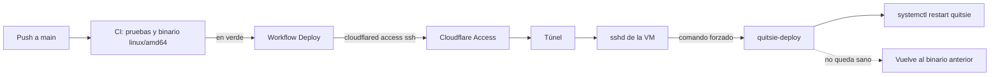

# Despliegue

Cómo sale Quitsie a Internet y cómo se opera. La infraestructura está decidida en el [ADR 0007](adr/0007-go-nativo-en-vm-gratuita.md) y resumida en [arquitectura.md](arquitectura.md#infraestructura-adr-0007): un binario Go con la PWA embebida y SQLite en una VM `e2-micro` de Google Cloud, con Cloudflare delante (DNS, CDN y Tunnel, sin puertos públicos) y Litestream replicando a R2.

## Costo real

| Pieza | Costo |
| --- | --- |
| VM `e2-micro` en `us-east1`, disco estándar de 30 GB, 1 GB de salida al mes | 0 (capa gratuita permanente) |
| **IP pública de la VM** | **~3,65 USD al mes** |
| Cloudflare (DNS, CDN, Tunnel, Access hasta 50 usuarios), R2 hasta 10 GB | 0 |
| Dominio | ~10–15 USD al año |

La IP pública no entra en la capa gratuita: Google cobra [0,005 USD por hora por cada IPv4 externa](https://cloud.google.com/vpc/network-pricing) de una VM estándar, y la exención es de una hora al mes. La VM la necesita para salir a Internet (`cloudflared`, Litestream y `apt` son conexiones salientes), aunque no recibe tráfico por ella. Es la única parte que contradice el «0 USD al mes» del ADR 0007; la guía de instalación avisa y propone un presupuesto de 5 USD con alertas para que ningún otro cargo pase desapercibido.

## Primer despliegue

Hay pasos que solo puede hacer su dueño: comprar el dominio, abrir cuentas, crear tokens y pagar. Una guía interactiva los recorre uno a uno, abre cada página, dice qué copiar y dónde va, y ejecuta por ti los comandos de `gcloud` y `gh` que no necesitan decisión:

```bash
bash deploy/first-deploy-wizard.sh
```

Requisitos en tu ordenador: `gh` con sesión iniciada (`gh auth login`) y `gcloud` (`brew install --cask gcloud-cli`). Se puede interrumpir con Ctrl-C y repetir: recuerda lo ya hecho en `.quitsie-wizard.env`, un archivo ignorado por git que solo guarda valores públicos.

| Etapa | Qué hace |
| --- | --- |
| 1 | Comprueba `gh`, `gcloud` y el repositorio. |
| 2 | Compras `quitsie.com` y `quitsie.app` en Cloudflare Registrar. |
| 3 | Creas el bucket de R2 `quitsie-backups`. |
| 4 | Creas el proyecto de Google Cloud, vinculas la facturación y pones un presupuesto de 5 USD. |
| 5 | Crea la VM y el cortafuegos: solo el rango de IAP de Google llega al puerto 22; se borran las reglas por defecto que abren la VM a Internet. |
| 6 | Creas el túnel de Cloudflare y publicas el dominio hacia `localhost:8080`. |
| 7 | Genera un par de claves SSH solo para desplegar; la privada va directa al secreto `DEPLOY_SSH_KEY`. |
| 8 | Creas el token de R2 para Litestream. |
| 9 | Copia `deploy/` a la VM y ejecuta `provision.sh`, donde escribes las claves de R2 y el token del túnel. |
| 10 | Creas un token de servicio de Cloudflare Access; sus dos valores van a secretos de GitHub. |
| 11 | Creas la aplicación de Access para `ssh.<dominio>` y después publicas esa ruta en el túnel. |
| 12 | Configura las variables de GitHub y lanza el primer despliegue. |
| 13 | Ejecuta la prueba de restauración. |

Al terminar, `https://<dominio>/` muestra la página de estado de la PWA y `https://<dominio>/api/v1/health` responde `{"status":"ok","database":"ok","version":"<commit>"}`.

### Dónde vive cada secreto

Nada secreto está en el repositorio ni pasa por un chat. Las plantillas `deploy/*.env.example` solo nombran las variables.

| Valor | Vive en | Lo escribe |
| --- | --- | --- |
| Account ID, Access Key ID y Secret Access Key de R2 | `/etc/quitsie/litestream.env` en la VM (modo 600) | `provision.sh`, con entrada oculta |
| Token del túnel de Cloudflare | `/etc/quitsie/cloudflared.env` en la VM (modo 600) | `provision.sh`, con entrada oculta |
| Claves de Resend y Google (cuando existan) | `/etc/quitsie/quitsie.env` en la VM (modo 600) | tú, con `sudoedit` |
| Clave SSH privada de despliegue | secreto `DEPLOY_SSH_KEY` de GitHub | el asistente, directo desde `ssh-keygen` |
| Token de servicio de Access | secretos `CF_ACCESS_CLIENT_ID` y `CF_ACCESS_CLIENT_SECRET` de GitHub | el asistente, con entrada oculta |
| Dominio, clave pública de la VM | variables `QUITSIE_URL`, `DEPLOY_SSH_HOST` y `DEPLOY_SSH_HOST_KEY` de GitHub (públicas) | el asistente |

## Despliegue continuo

[`.github/workflows/deploy.yml`](../.github/workflows/deploy.yml) arranca cuando la CI termina en verde sobre un push a `main`:



- **Despliega exactamente el binario que construyó la CI** para ese commit, no uno recompilado. Si `main` ya avanzó, lo omite: el commit más nuevo se despliega solo cuando pase su CI.
- **Un solo despliegue a la vez.** Uno en curso nunca se cancela.
- **Entra por Access y por SSH.** `ssh.<dominio>` solo acepta el token de servicio de GitHub; después, la clave SSH. En la VM, esa clave tiene un comando forzado: solo puede ejecutar `quitsie-deploy`, sin shell ni reenvíos, y `sudoers` solo deja a ese usuario ejecutar ese script, sin argumentos. El binario viaja por stdin.
- **Se verifica y se revierte.** `quitsie-deploy` guarda el binario anterior, reinicia el servicio y espera hasta 30 s a que `/api/v1/health` responda. Si no, restaura el anterior y el workflow falla. Después el workflow comprueba que la URL pública devuelva el commit desplegado en `version`.
- **Interruptor.** Sin la variable `DEPLOY_SSH_HOST` el workflow no hace nada, así que `main` no se pone en rojo antes de terminar la instalación. El asistente la crea en la etapa 12.
- **A mano.** Desde la pestaña Actions, o con `gh workflow run deploy.yml --ref main`, se vuelve a desplegar el último CI en verde de `main`.

Las migraciones se aplican al arrancar y solo avanzan. Si un despliegue revierte, el binario viejo arranca contra el esquema nuevo: mantén cada migración compatible con la versión anterior (añadir antes de quitar).

## Operar la VM

Acceso de emergencia, sin pasar por Cloudflare:

```bash
gcloud compute ssh quitsie --zone us-east1-b --tunnel-through-iap
```

Estado y registros:

```bash
systemctl status quitsie litestream cloudflared
journalctl -u quitsie -n 100 --no-pager
journalctl -u litestream -u quitsie-restore -n 50 --no-pager
curl -s http://127.0.0.1:8080/api/v1/health
```

| Pieza | Unidad o archivo | Notas |
| --- | --- | --- |
| Aplicación | `quitsie.service`, `/usr/local/bin/quitsie` | Escucha en `127.0.0.1:8080`; la base está en `/var/lib/quitsie/quitsie.db` (0750, solo `quitsie`). |
| Restauración al arrancar | `quitsie-restore.service` | Solo actúa si no hay base. Tiene las credenciales de R2; la aplicación no. Si R2 no responde en una VM nueva falla, y la aplicación y Litestream no arrancan: mejor parada que con una base vacía que se aparte del respaldo. |
| Respaldo | `litestream.service`, `/etc/litestream.yml` | Réplica continua a R2; conserva una semana de puntos de restauración. |
| Entrada | `cloudflared.service` | Se actualiza con `apt upgrade`. |
| Despliegue | `/usr/local/sbin/quitsie-deploy` | Lo ejecuta el usuario `deploy`. |

**Aplicar cambios de `deploy/`** (unidades, `litestream.yml`, versión de Litestream): conecta por IAP, actualiza el checkout y ejecuta otra vez `sudo bash deploy/provision.sh`. Es idempotente y no vuelve a pedir lo que ya tiene. Para subir Litestream, cambia `LITESTREAM_VERSION` y `LITESTREAM_SHA256` en `provision.sh` (el digest sale de `gh api repos/benbjohnson/litestream/releases/tags/v<versión>`).

**Actualizaciones del sistema.** `unattended-upgrades` aplica las de seguridad. Cuando haya una de kernel, reinicia la VM de vez en cuando (`sudo reboot`): todo arranca solo.

**Rotar secretos**

| Qué | Cómo |
| --- | --- |
| Token de R2 | Crea uno nuevo en R2, `sudoedit /etc/quitsie/litestream.env`, `sudo systemctl restart litestream`, y revoca el viejo. |
| Token del túnel | Gíralo en el panel del túnel, `sudoedit /etc/quitsie/cloudflared.env`, `sudo systemctl restart cloudflared`. Hazlo por IAP: el reinicio corta el túnel. |
| Token de servicio de Access | Caduca (el asistente te pide anotar la fecha). Crea otro y repite la etapa 10; mientras tanto el despliegue falla con un error de Access. |
| Clave SSH de despliegue | Repite la etapa 7 (generar una nueva) y la 9 (reinstalar la pública). |

## Respaldo y restauración

Litestream lee el WAL de SQLite y copia los cambios a `s3://quitsie-backups/quitsie.db` en R2 con un retraso de alrededor de un segundo, más una instantánea diaria. Con el intervalo por defecto escribe en R2 una vez por segundo mientras la aplicación escribe; la capa gratuita de R2 incluye 1.000.000 de escrituras al mes (comprueba la cifra vigente en el panel). Con poco tráfico sobra; si algún día se acerca, sube `sync-interval` en `litestream.yml`.

### Prueba de restauración

Un respaldo que nunca se ha restaurado no es un respaldo. Haz la prueba al terminar la instalación, después de cualquier cambio en R2 o en las credenciales, y una vez al mes. En la VM:

```bash
sudo quitsie-restore-test
```

Restaura el último respaldo en una carpeta temporal con `litestream restore -integrity-check full`, comprueba `PRAGMA integrity_check`, compara la versión de sincronización del respaldo con la de la base viva y termina con `OK` o con error. No toca la base real ni la réplica. Es lo mismo que, a mano:

```bash
sudo -i
set -a; . /etc/quitsie/litestream.env; set +a
litestream restore -config /etc/litestream.yml -o /var/tmp/restored.db -integrity-check full /var/lib/quitsie/quitsie.db
sqlite3 /var/tmp/restored.db 'PRAGMA integrity_check;'      # ok
```

Para volver a un instante anterior (por ejemplo, tras un borrado masivo), añade `-timestamp 2026-10-20T15:00:00Z`; cada restauración necesita su propia ruta de salida. Primero ejecuta con `-dry-run` para ver a qué punto llegaría.

### Perder la VM

1. **Apaga o borra la VM vieja** si sigue viva: dos máquinas replicando a la misma ruta de R2 estropean el respaldo.
2. Crea una VM nueva (etapa 5 del asistente) y ejecuta `provision.sh` con las mismas claves de R2 y el token del túnel. Al arrancar Litestream, `quitsie-restore` trae la base de R2 antes de que nada la use.
3. Actualiza la variable `DEPLOY_SSH_HOST_KEY` de GitHub (la VM nueva tiene otra clave de host; `provision.sh` la imprime al final) y lanza el despliegue: `gh workflow run deploy.yml --ref main`.

## Dominio secundario

Con `quitsie.com` como principal, haz que `quitsie.app` redirija a él: añade a su zona un registro `A` proxied (nube naranja) hacia `192.0.2.1`, que no recibe tráfico real, y crea una Redirect Rule (Rules → Redirect Rules) de `quitsie.app` a `https://quitsie.com`. `.app` solo funciona con HTTPS, lo cual Cloudflare ya garantiza.

## Si algo falla

| Síntoma | Causa probable |
| --- | --- |
| `https://<dominio>` responde 530 (error 1033) | `cloudflared` no está conectado: `journalctl -u cloudflared`, o el token es incorrecto. |
| Responde 502 | El túnel funciona pero no hay aplicación: aún no hay despliegue, o `quitsie.service` no arrancó (`journalctl -u quitsie`). |
| `quitsie.service` dice «dependency failed» | `quitsie-restore.service` falló: credenciales de R2 incorrectas o R2 inaccesible (`journalctl -u quitsie-restore`). No arranca a propósito. |
| El workflow falla en «Install the binary…» con un error de Access o 255 | Token de servicio caducado o mal copiado, o la aplicación de Access no incluye el token en una política Service Auth. |
| El workflow falla con «host key verification failed» | La variable `DEPLOY_SSH_HOST_KEY` no es la de la VM actual. |
| El deploy termina con «rolling back» | El binario nuevo no llegó a estar sano; el anterior sigue sirviendo. El log trae las últimas líneas del servicio. |
| Una unidad no arranca por el aislamiento (`status=2xx` en `systemctl status`) | Se endureció sin poder probarlo en la VM real. Comenta la directiva sospechosa en `deploy/` (p. ej. `CapabilityBoundingSet=` o `RestrictNamespaces=`), vuelve a ejecutar `provision.sh` y avisa para corregir el archivo. |

## Qué contiene `deploy/`

| Archivo | Para qué |
| --- | --- |
| `first-deploy-wizard.sh` | La guía interactiva del primer despliegue. |
| `provision.sh` | Prepara la VM (idempotente). |
| `quitsie-deploy.sh` | Se instala como `/usr/local/sbin/quitsie-deploy`: instala el binario, reinicia y revierte. |
| `restore-test.sh` | Se instala como `/usr/local/sbin/quitsie-restore-test`. |
| `quitsie.service`, `quitsie-restore.service`, `litestream.service`, `cloudflared.service` | Unidades systemd. |
| `litestream.yml` | Configuración de Litestream (sin secretos). |
| `*.env.example` | Nombres de las variables de `/etc/quitsie/*.env`. |
